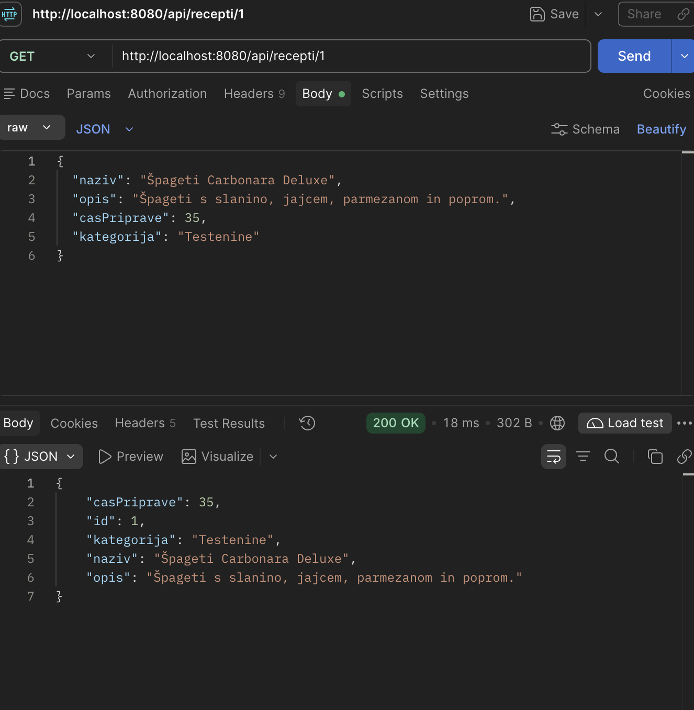
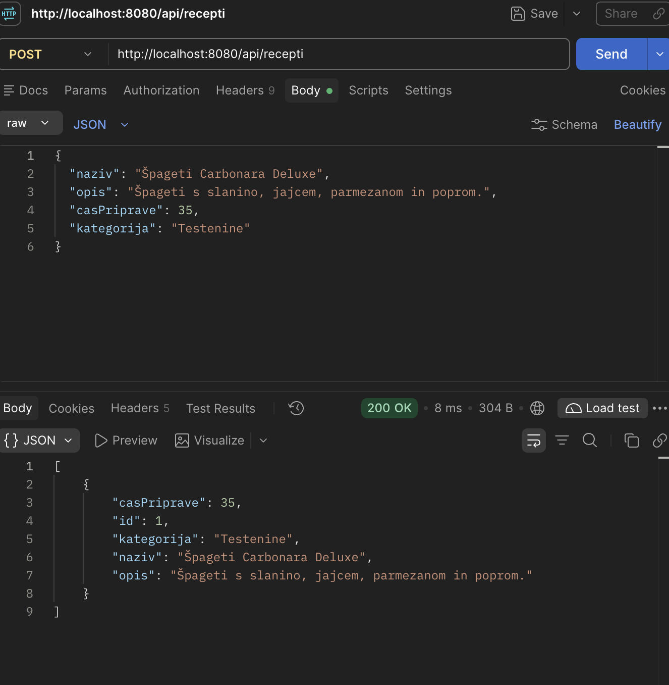
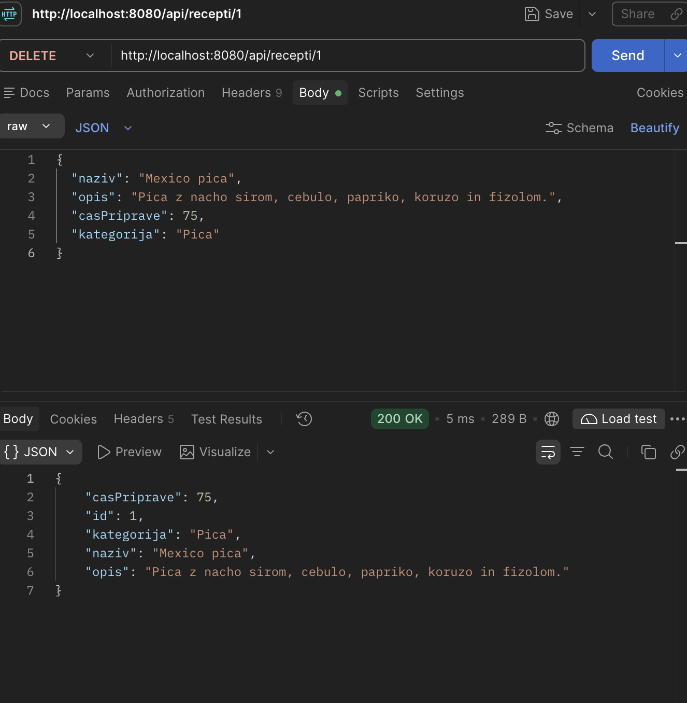
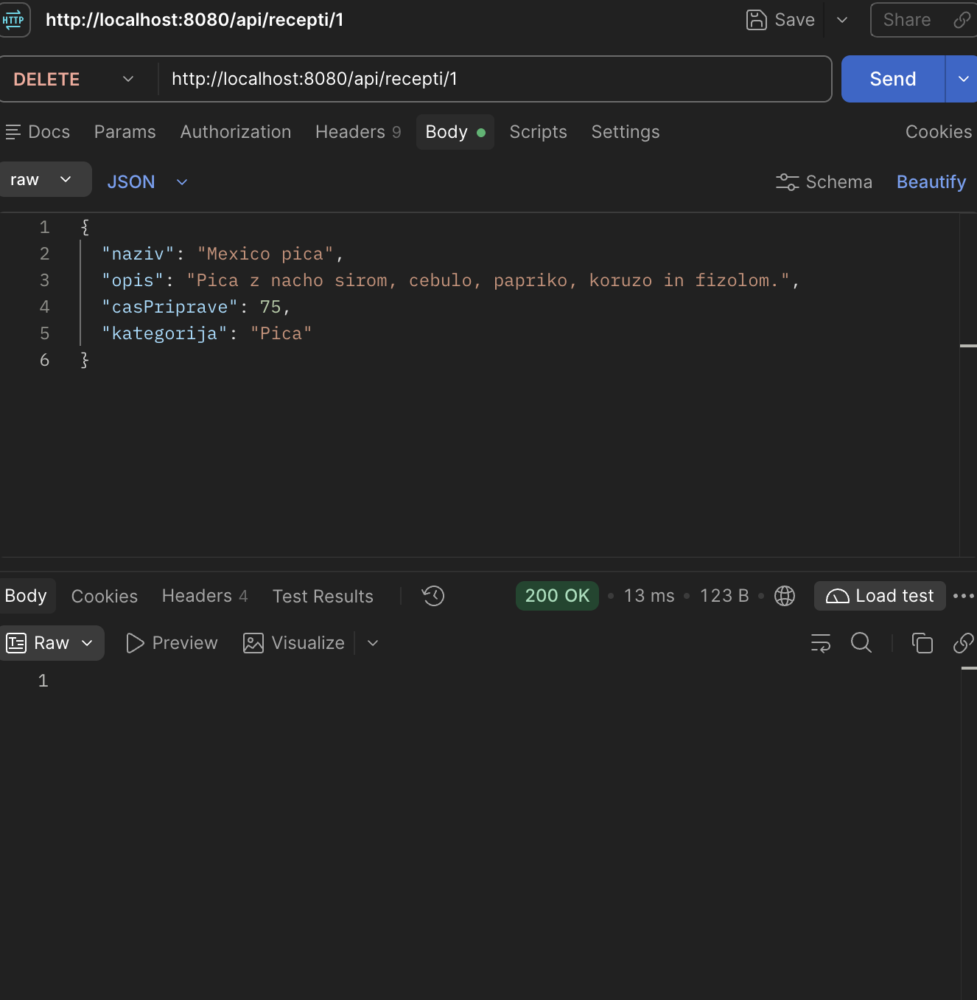

RIS - Aplikacija z recepti

Opis:
\
Aplikacija na kateri uporabniki lahko poiščejo že ustvarjene recepte, ali pa objavijo svoje.
\
Vsak recept vsebuje naziv, čas priprave, navodila priprave, sestavine (ki imajo tudi količino) in ima dodeljeno kategorjio, za lažje filtriranje ipd.
\
Navodila priprave so napisana po korakih za lepši izpis
\
Uporabnikom je najprej viden naziv recepta in njegov opis, za več podatkov se odpre stran recepta
\
\
Profil: public/private, seznam svojih receptov, seznam shranjenih/všečkanih receptov, ogled drugih public profilov za dostop do njihovih objavljenih receptov
\
Domača stran: prikaz kategorij, "viralnih" receptov (mogoce nek leaderboard najpopularnejsih receptov), search bar, takojšen dostop do kategorij...
\
\
Iskanje receptov po kategoriji, nazivih, profilih, času priprave, sestavinah, "keywordih" 
\
\
\
\
\
\
kasnejsi TODO (mogoce):
\
-slike receptov
\
-zbiranje "všečkov" na receptih po modelu socialnih medijev
\
\
\
ideja: stil scrollanja postanih receptov kot v reddit/tiktok (social media style)
\
"mobile device oriented"


\
Primer recepta (s sestavinami):
```json
{
  "naziv": "Špageti Carbonara",
  "opis": "Špageti s slanino, jajcem in parmezanom.",
  "casPriprave": 30,
  "kategorija": "Testenine",
  "navodilaPriprave": "1. Skuhaj špagete.\n2. Popeci slanino.\n3. Zmešaj jajca in parmezan ter vse skupaj premešaj.",
  "sestavine": [
    {"naziv": "Špageti", "kolicina": "400 g"},
    {"naziv": "Slanina ali panceta", "kolicina": "150 g"},
    {"naziv": "Jajca", "kolicina": "4"},
    {"naziv": "Parmezan", "kolicina": "100 g"},
    {"naziv": "Sol", "kolicina": "po okusu"},
    {"naziv": "Črni poper", "kolicina": "po okusu"}
  ]
}
```


Uporaba metode GET (iskanje po ID)


Uporaba metode GET (pregled vseh receptov)
.png)

Uporaba POST metode


Uporaba PUT metode z ID 1


Uporaba DELETE metode po ID-ju



<!--  -->

Delovanje H2 baze znotraj pomnilnika

